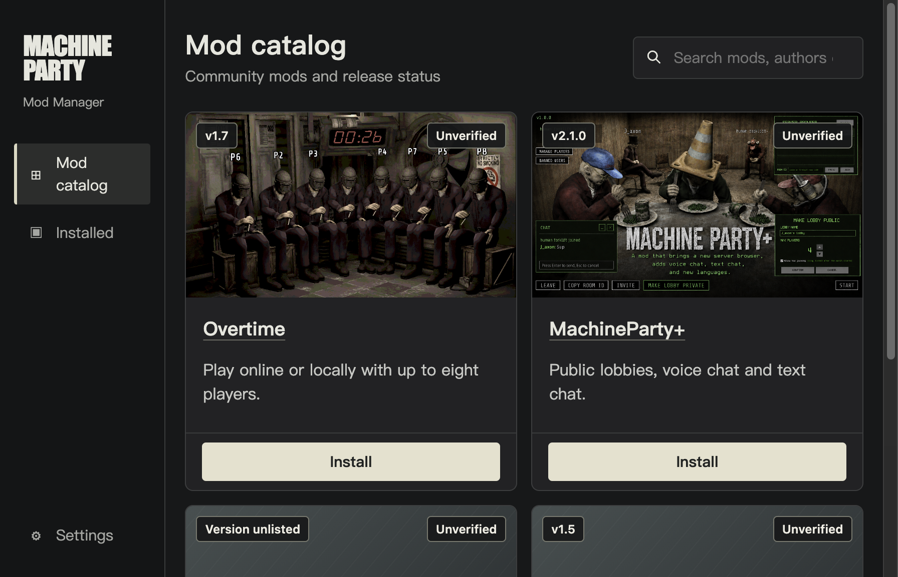

# Machine Party Mod Manager

**English** · [简体中文](docs/readme/README.zh-CN.md) · [繁體中文](docs/readme/README.zh-TW.md)

A free, non-profit desktop tool for [Machine Party](https://store.steampowered.com/app/4108000/Machine_Party/). Players search mods that the team has catalogued by hand, read about them, visit the author's page and, once verified, install and uninstall them from one window. The app finds the Steam game folder on first launch.

## Status

Early prototype built with Rust and Tauri 2.

- Available now: the bundled catalog with search in Simplified Chinese, Traditional Chinese and English, mod details, Steam game detection and manual folder selection, per-copy version comparison and signed in-app updates for the manager itself.
- The Windows preview supports Overtime v1.7 on the pinned v2.1.2 game build. Choose Install once. The dialog downloads the package if needed, verifies it and installs it. Cached packages can be installed offline. Close the game before modifying a copy. Other catalog entries list compatibility as unconfirmed until a supported build is documented.

## Download

Get the latest build from [Releases](https://github.com/JamesGZM/machine-party-mod-manager/releases/latest).

- **Windows x64**: run `setup.exe`.
- **Apple Silicon Mac**: extract `MachineParty-aarch64.app.tar.gz` and move the app to a writable Applications folder. It is ad hoc signed and not notarised.

Installed copies update themselves from Settings or when prompted at startup.

## Documentation

| Guide | Purpose |
| --- | --- |
| [Product requirements](docs/en/requirements.md) | Player flows, catalog order, search and acceptance criteria |
| [Current architecture](docs/en/architecture/README.md) | Components, Steam detection, catalog, installs and ADRs |
| [Development guide](docs/en/development/README.md) | Setup, layout, commands and verification |
| [Releasing](docs/en/development/releasing.md) | Signed desktop updates and the release workflow |
| [Candidate mods and inclusion](docs/en/catalog/mods.md) | Game baseline, candidates, licences and the acceptance checklist |
| [Catalog delivery](docs/en/catalog/delivery.md) | Worker catalog, owner-approved publishing and mainland China acceptance (planned) |
| [UI design](docs/en/ui-design.md) | Layout, cards, states and planned flows |

All guides: [docs](docs/README.md).

## Contributing

Recommend a mod or submit a new version with the [mod submission form](https://github.com/JamesGZM/machine-party-mod-manager/issues/new?template=mod-submission.yml). For bugs, features and code, read [CONTRIBUTING.md](CONTRIBUTING.md). Coding agents follow [AGENTS.md](AGENTS.md). Get help through [SUPPORT.md](SUPPORT.md) and report vulnerabilities privately as described in [SECURITY.md](SECURITY.md).

## License

The manager is licensed under the [GNU General Public License v3.0 only](LICENSE) (SPDX `GPL-3.0-only`). Official builds are free.

Machine Party Mod Manager is a community project and is not affiliated with the game's developer. The game, third-party mods and cover images belong to their respective owners and keep their own licences; authors, versions and sources are shown on each entry. See [THIRD_PARTY_NOTICES.md](THIRD_PARTY_NOTICES.md).
