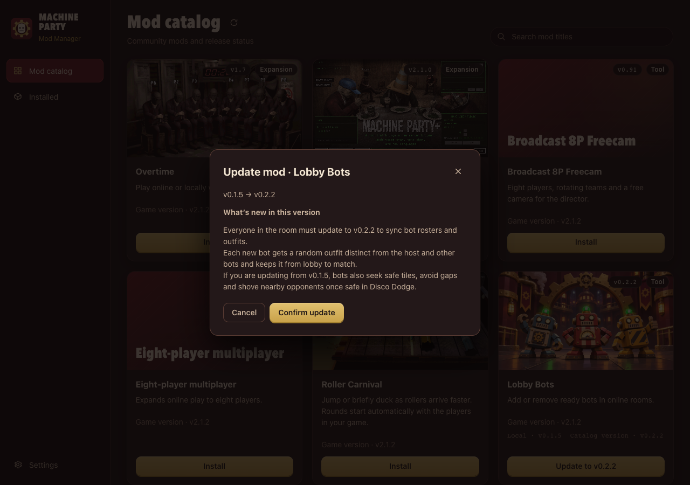

# Getting help

**English** · [简体中文](docs/zh-CN/SUPPORT.md) · [繁體中文](docs/zh-TW/SUPPORT.md)

## Before asking

- Check the [README](README.md) for downloads and the mod installation features available in the Windows preview.
- Check [existing issues](https://github.com/JamesGZM/machine-party-mod-manager/issues), including closed ones.

## Updating one installed mod

Close the game before updating a mod.

- **Windows preview 0.1.2-11** — Open **Installed** and select **Check mod updates**. Select **Update to**, check the versions and the game copy, then select **Confirm update**. This version shows the game path in the confirmation.
- **Development build shown below** — Open **Mod catalog** and select **Refresh mod list**. Select **Update to**, check the versions and any release notes, then select **Confirm update**. If a refresh adds or revises notes in your language while the dialog is open, review the revised text and confirm again.

If package verification fails, the previous version stays installed. After an interrupted replacement, close the game and reopen the manager to recover the recorded version. The details for a mod with an available update also offer **Uninstall** in the catalog.

## Removing an MPML mod

Open **Installed** and choose **Uninstall**. The dialog shows the version installed in that game copy. If you reinstalled a clean copy of the same supported game build in the same folder and a previous MPML installation shows **Repair needed**, open **View details** and choose **Uninstall** to clear its record. Once verification completes, you can install the mod again.

## Where to ask

| Situation | Where |
| --- | --- |
| The manager misbehaves or crashes | [Bug report](https://github.com/JamesGZM/machine-party-mod-manager/issues/new?template=bug_report.yml) |
| An idea or missing feature | [Feature request](https://github.com/JamesGZM/machine-party-mod-manager/issues/new?template=feature_request.yml) |
| Recommend a mod or a new mod version | [Mod submission](https://github.com/JamesGZM/machine-party-mod-manager/issues/new?template=mod-submission.yml) |
| A security problem | Privately, as described in [SECURITY.md](SECURITY.md) |

## What to include

Your operating system, manager version (Settings), Steam game version, whether the game folder was detected or chosen manually, the steps you took and what you expected. Remove personal information from paths and screenshots.

Problems inside a mod itself, or with the game, belong with the mod's author or the game's developer. The manager links to each author from the mod details.
