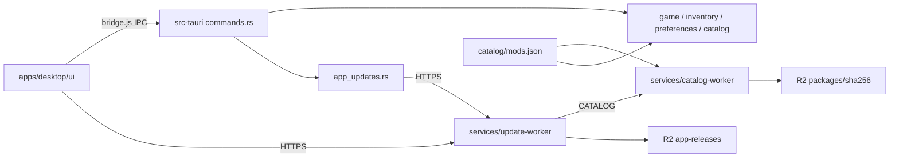

# Current architecture

**English** · [简体中文](../../zh-CN/architecture/README.md) · [繁體中文](../../zh-TW/architecture/README.md)

This is the single current architecture document. Significant decisions are recorded as ADRs in this directory. Installation, switching and recovery are still a design draft awaiting physical verification.

## Components and boundaries

| Directory | Responsibility |
| --- | --- |
| `apps/desktop/src-tauri` | Tauri 2 shell. `main.rs` only assembles; `commands.rs` decodes and validates IPC and delegates; `game.rs` recognizes Steam game copies; `inventory.rs` reads per-copy installation records; `preferences.rs` stores the manual choice; `catalog.rs` embeds the catalog and restricts which author pages may open; `app_updates.rs` owns signed updates. |
| `apps/desktop/ui` | Native ES modules with no build step. `bridge.js` is the only file that touches Tauri; `catalog.js` and `versions.js` are pure; `state.js` holds UI state; each `*-view.js` renders. Styling has three layers: design tokens in `tokens.css`, shared components in `components.css` and page layout in `style.css`; `dom.js` and `icons.js` create components and icons. |
| `catalog/mods.json` | Single source of mod IDs, order, versions, three-language text and aliases ([ADR-002](ADR-002-catalog-source.md)). |
| `services/update-worker` | Read-only Worker serving the stable manifest and version-pinned installers from R2 ([ADR-003](ADR-003-desktop-updates.md)). |
| `scripts`, `tests` | Release, deployment, acceptance and boundary checks. Node tests are grouped as `ui`, `contracts` and `architecture`; Rust unit tests sit beside their modules. |

Local data lives in the app configuration directory. `game-path.json` stores the chosen game path. In `installations.json` the first-level key is the game path, the second is `owner/repo`, and the value is the version this manager installed. The UI language is kept in WebView localStorage.

## Locating and identifying the game

Machine Party on Steam (App ID 4108000) is Windows-only; playing the game on macOS is out of scope. The app reads Steam library folders, finds the manifest for App ID 4108000 in each library, and separates the saved game root path (used as the key in `installations.json`) from the resolved inner directory that holds the game executable and `Machine Party.pck` (such as `Machine Party_Windows`). It records the Steam build, the actual path and data file hashes; compatibility is defined by tested combinations. When a player moves the game it is rechecked, and backups are stored per copy with pre-install fingerprints.

## Catalog, search and downloads

Maintainers publish fixed mod IDs, catalog order, author, README summary, aliases and home page. Each installable version also records the upstream tag or commit, asset name, SHA-256, supported game fingerprints, install method, required loader version, known conflicts and download path. The app caches the last catalog it read successfully.

The production catalog is served through a Cloudflare Worker on a custom domain. Releases deploy a reviewed snapshot; GitHub is used for collaboration and publishing, and browsing never depends on reaching GitHub. Downloads for mainland China go through the same Worker domain first. Verified originals that may be redistributed go into private R2; other assets are streamed from upstream only if licensing and route tests allow; author-direct-only assets are marked as such. The client reads the Worker snapshot at startup and caches validated data for offline browsing. Each version maps its Release asset ID to the R2 key `packages/sha256/<sha256>.zip`. Only packages cleared for mirroring are served. Endpoint contracts, failure handling, publishing and carrier acceptance are in the [catalog delivery plan](../catalog/delivery.md).

## Install, switch and recovery (design draft)

See [ADR-005](ADR-005-install-transactions.md) and [ADR-007](ADR-007-mod-adapters.md) for the full flow and constraints. In short: a Tauri-free Rust transaction engine locks the copy, checks the game process, version, space and conflicts, downloads and verifies packages in staging from the Worker origin, records pre-install fingerprints and a tiered backup (mirrored delta restore data plus offline CLI where supported, or a full PCK backup), and dispatches to a built-in adapter factory (`upstream-cli`, `loader-files`) using declarative `adapter` profiles in `catalog/mods.json`. It records success only after read-back verification, reconciles disk state after interruption, and stops rather than overwrites when Steam updated the game or unknown modifications exist. On macOS, development verification runs across three simulation tiers (L1 synthetic PCK and `FakeRunner`, L2 real subprocesses, and L3 local vanilla PCK with Mono) before physical Windows P2 acceptance.

## Whether to maintain forks

Use the author's published CLI or underlying install script first. The app itself can take on detection, backup and verification. If an interaction or restoration problem cannot be solved from outside, record a reproducible case and prefer a small upstream change. Maintain an installer fork only when licensing allows and it is truly necessary, keeping original authorship, source and version mapping.

## Architecture decision records

- [ADR-001: Project boundaries, keeping Tauri and native JS](ADR-001-project-boundaries.md)
- [ADR-002: Single source for the mod catalog](ADR-002-catalog-source.md)
- [ADR-003: Signed desktop updates](ADR-003-desktop-updates.md)
- [ADR-004: Documentation organised by language](ADR-004-language-documentation.md)
- [ADR-005: Mod install transactions and backups (proposed)](ADR-005-install-transactions.md)
- [ADR-006 · Online mod catalog](ADR-006-online-catalog.md)
- [ADR-007: Mod adapters and macOS simulation (proposed)](ADR-007-mod-adapters.md)
- [ADR-008 · Cached downloads, startup checks and verified restoration](ADR-008-cached-installations.md)
