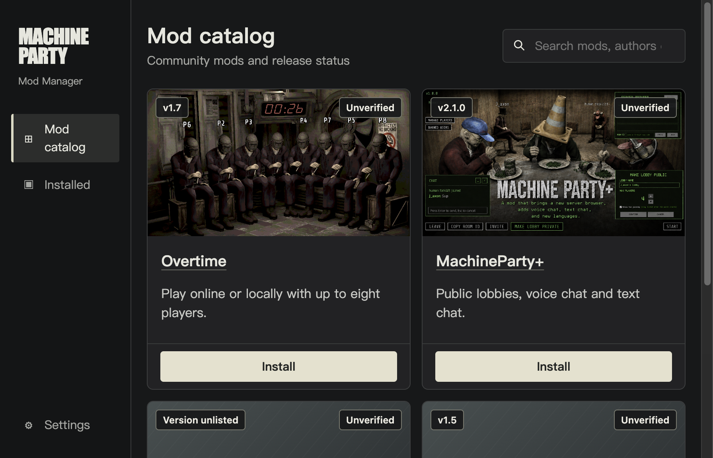
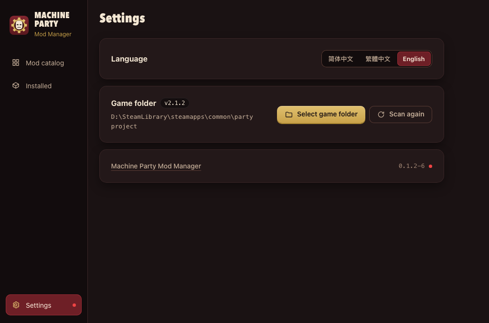
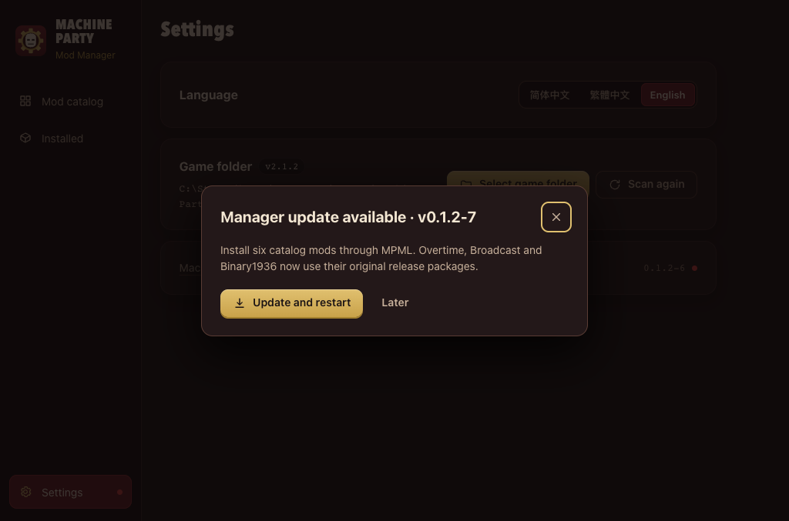

# Machine Party 模组管理器

### 为 Machine Party 打造的一键模组管理器。

在同一个窗口浏览 [Machine Party](https://store.steampowered.com/app/4108000/Machine_Party/) 的精选社区模组与内置玩法模组，按游戏副本对比版本，并在校验与备份保护下完成安装与还原。

  
  
  

  
  
  

**[下载](#下载)** · [开始使用](#开始使用) · [文档](../zh-CN/README.md) · [更新记录](../zh-CN/CHANGELOG.md)

[English](../../README.md) · **简体中文** · [繁體中文](README.zh-TW.md)

  

桌面端目录界面，展示包含内置模组《滚筒嘉年华》在内的全部五个 <code>v2.1.2</code> Windows 测试版条目。

## 一目了然

| 精选收录与内置模组 | 校验备份，安全还原 | 镜像加速与签名更新 |
| --- | --- | --- |
| 支持简体中文、繁体中文与英文别名搜索、联机说明与作者主页入口，并内置自研模组《滚筒嘉年华》。 | 修改文件前先检查游戏进程、基线指纹与互斥冲突；按游戏副本保留可校验备份，支持离线卸载还原。 | 目录同步与已授权安装包优先经项目 Cloudflare Worker 获取，不依赖访问 GitHub；应用更新带签名校验与更新说明。 |

Steam 目录自动检测 · 离线缓存与还原 · 简体中文 / 繁體中文 / English 三语界面

## 下载

直接通过下方镜像链接或前往 [GitHub Releases](https://github.com/JamesGZM/machine-party-mod-manager/releases/latest) 下载对应平台安装包。

| 平台 | 架构 | 下载 | 说明 |
| --- | --- | --- | --- |
| Windows | x64 | [正式版 v0.1.1（`setup.exe`）](https://machineparty.ailaogong.men/v1/app-downloads/0.1.1/setup.exe) · [测试版 v0.1.2-3（`setup.exe`）](https://machineparty.ailaogong.men/v1/app-downloads/0.1.2-3/setup.exe) | NSIS 安装包，支持签名应用内更新 |
| macOS | Apple Silicon | [正式版 v0.1.1（`MachineParty-aarch64.app.tar.gz`）](https://machineparty.ailaogong.men/v1/app-downloads/0.1.1/MachineParty-aarch64.app.tar.gz) | 浏览目录与接收应用更新（游戏仅限 Windows） |

Windows 下载后运行 NSIS 安装程序即可；Apple Silicon Mac 解压归档并将 `.app` 移入可写的应用程序目录。

**Steam 上的《机械派对》（Machine Party）仅支持 Windows；当前 `0.1.2-6` 工作区已为目录内全部五个模组接入 `v2.1.2` 适配器，仍待完整 Windows 实机验收。** macOS 构建仅作 ad hoc 签名，未经 Apple 公证；Windows 安装包在未配置代码签名证书时为未签名包。已安装客户端会在启动时静默检查更新，在设置页显示红点，并在发现新版时弹出可延后处理的更新说明弹窗。详见[发布流程与验证说明](../zh-CN/development/releasing.md)。

## 开始使用

1. 启动管理器，应用会自动定位 Steam 中的 *Machine Party*（App ID `4108000`），也可在**设置**手动选择游戏目录。
2. 支持三语搜索与浏览全部已收录模组，点击标题可查看联机要求、冲突规则、兼容游戏版本与作者主页。
3. 确认游戏完全退出后，点击**安装**，管理器会自动下载（或复用离线缓存）、校验 SHA-256、创建备份并应用修改。
4. 在**已安装**页面可离线卸载并校验原版还原结果；在**设置**页面可切换界面语言、更换游戏目录或检查管理器更新。

## 桌面应用

| 设置页 | 应用内更新提示 |
| --- | --- |
|  |  |

## 已收录模组

| 模组 | 版本 | 简介 | 适配方式与 `v2.1.2` 状态 |
| --- | --- | --- | --- |
| [Overtime](https://github.com/DarkJadeStone/MachineParty-Overtime) | `v1.7` | 最多 8 人在线或本地同玩 | 直接改包 CLI（`upstream-cli`，Windows 测试版） |
| [MachineParty+](https://github.com/Ghostx10742/MachineParty-Plus) | `v2.1.0` | 公开房间、语音与文字聊天 | 加载器模组（`loader-files`，Windows 测试版） |
| [Broadcast 8P Freecam](https://github.com/Lnksoul/MachineParty_Broadcast8P_Freecam_Patcher) | `v0.91` | 8 人团播、四队轮换与导播自由镜头 | PowerShell 补丁（`upstream-cli`，Windows 测试版） |
| [八人联机模组](https://github.com/Binary1936/machine-party-8p) | `v1.5` | 将在线游戏扩展至 8 人 | 内置 Python 补丁（`upstream-cli`，Windows 测试版） |
| [滚筒嘉年华](https://github.com/JamesGZM/machine-party-mod-manager/tree/main/mods/roller-carnival) | `v0.1.0` | 机械狂欢躲避小游戏 | 加载器模组（`loader-files` + `autoLoader`，R2 ZIP，Windows 测试版） |

验收清单、上游授权边界与互斥组规则详见[候选模组与收录规范](../zh-CN/catalog/mods.md)。

## 更新记录

当前开发版本 **0.1.2-6** 为全部五个目录模组统一接入 R2 + Worker 分发与 Windows `v2.1.2` 适配器，优化设置页（三段式语言切换、右对齐目录操作与 GitHub 链接合并行），并上线带更新说明的非强制启动更新弹窗。[完整更新记录](../zh-CN/CHANGELOG.md)。

## 文档

| 文档 | 用途 |
| --- | --- |
| [产品需求](../zh-CN/requirements.md) | 玩家流程、目录顺序、搜索及验收条件 |
| [现行架构](../zh-CN/architecture/README.md) | 组件、Steam 检测、目录、安装与 ADR |
| [开发指南](../zh-CN/development/README.md) | 环境、目录结构、命令与验证 |
| [发布流程](../zh-CN/development/releasing.md) | 签名桌面更新、更新说明与发布工作流 |
| [候选模组与收录规范](../zh-CN/catalog/mods.md) | 游戏基线、候选清单、授权与验收单 |
| [正式目录交付方案](../zh-CN/catalog/delivery.md) | Worker 目录、所有者批准发布与中国大陆验收（规划中） |
| [界面设计规范](../zh-CN/ui-design.md) | 布局、卡片、设置页、弹窗与规划中的流程 |

全部文档：[docs](../README.md)。

## 隐私

管理器不包含任何遥测或统计埋点。游戏路径（`game-path.json`）、副本安装记录（`installations.json`）、下载缓存与备份文件全部保存在本地；仅在获取在线目录、已授权模组包与签名应用更新时连接项目 Worker。分享诊断信息前请阅读[安全说明](../zh-CN/SECURITY.md)。

## 参与贡献

推荐模组或提交新版本，请填写[模组投稿表单](https://github.com/JamesGZM/machine-party-mod-manager/issues/new?template=mod-submission.yml)。报告问题、提出功能或贡献代码请阅读[贡献指南](../zh-CN/CONTRIBUTING.md)。编码助手遵循 [AGENTS.md](../../AGENTS.md)。获取帮助见[支持说明](../zh-CN/SUPPORT.md)，安全漏洞请按[安全说明](../zh-CN/SECURITY.md)私下报告。

## 许可证

管理器代码采用 [GNU General Public License v3.0 only](../../LICENSE)（SPDX `GPL-3.0-only`）。官方版本免费提供。

Machine Party 模组管理器是社区项目，与游戏开发者无关。游戏、第三方模组与封面图片属于各自的权利人并适用其授权；作者、版本和来源保留在各条目页面。见[第三方声明](../zh-CN/THIRD_PARTY_NOTICES.md)。

## 致谢

- 社区模组作者：[DarkJadeStone (Overtime)](https://github.com/DarkJadeStone/MachineParty-Overtime)、[Ghostx10742 (MachineParty+)](https://github.com/Ghostx10742/MachineParty-Plus)、[Lnksoul (Broadcast 8P Freecam)](https://github.com/Lnksoul/MachineParty_Broadcast8P_Freecam_Patcher)、[Binary1936 (八人联机模组)](https://github.com/Binary1936/machine-party-8p) 与 [Krunk-theduck (MPML)](https://github.com/Krunk-theduck/MachinePartyModLoader)。
- [Tauri](https://tauri.app/) 以及[第三方声明](../zh-CN/THIRD_PARTY_NOTICES.md)中所列的开源 Rust 与 JavaScript 依赖。
