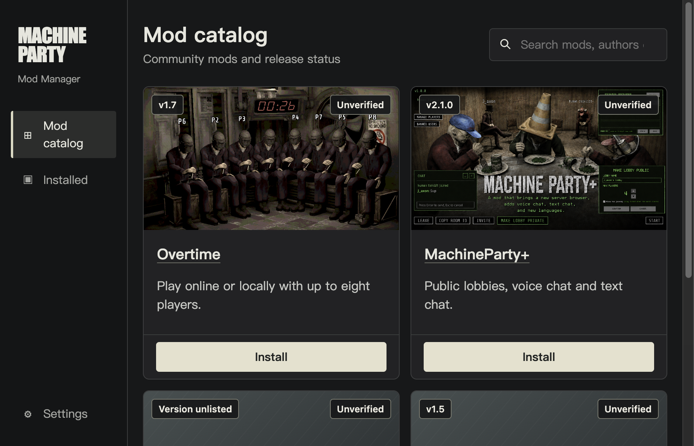

# Machine Party 模組管理器

[English](../../README.md) · [简体中文](README.zh-CN.md) · **繁體中文**

為 [Machine Party](https://store.steampowered.com/app/4108000/Machine_Party/) 打造的免費、非營利桌面工具。玩家可以搜尋團隊手動收錄的模組、查看說明與作者首頁，並在通過驗證後於同一個視窗完成安裝與卸載。首次使用時自動尋找 Steam 遊戲目錄。

## 專案階段

以 Rust 與 Tauri 2 建置的早期原型。

- 已提供：隨包發布的目錄，支援簡體中文、繁體中文與英文搜尋；模組詳情；Steam 遊戲偵測與手動選擇目錄；按遊戲副本比較版本；管理器本身的簽章更新。
- Windows 測試版可在指定的 v2.1.2 遊戲副本上測試 Overtime v1.7。先下載一次，隨後可離線安裝和解除安裝。操作前請完全退出遊戲。其他模組取得對應版本的依據前會顯示「支援版本待確認」。

## 下載

從 [Releases](https://github.com/JamesGZM/machine-party-mod-manager/releases/latest) 下載最新版本。

- **Windows x64**：執行 `setup.exe`。
- **Apple Silicon Mac**：解壓 `MachineParty-aarch64.app.tar.gz`，把 App 移到可寫入的應用程式目錄。此版本使用 ad hoc 簽章，未經公證。

安裝後可在設定頁或啟動提示中自動更新。

## 文件

| 文件 | 用途 |
| --- | --- |
| [產品需求](../zh-TW/requirements.md) | 玩家流程、目錄順序、搜尋及驗收條件 |
| [現行架構](../zh-TW/architecture/README.md) | 元件、Steam 偵測、目錄、安裝與 ADR |
| [開發指南](../zh-TW/development/README.md) | 環境、目錄結構、命令與驗證 |
| [發布流程](../zh-TW/development/releasing.md) | 簽章桌面更新與發布工作流程 |
| [候選模組與收錄規範](../zh-TW/catalog/mods.md) | 遊戲基線、候選清單、授權與驗收單 |
| [正式目錄交付方案](../zh-TW/catalog/delivery.md) | Worker 目錄、擁有者批准發布與中國大陸驗收（規劃中） |
| [介面設計規範](../zh-TW/ui-design.md) | 版面、卡片、狀態與規劃中的流程 |

全部文件：[docs](../README.md)。

## 參與貢獻

推薦模組或提交新版本，請填寫[模組投稿表單](https://github.com/JamesGZM/machine-party-mod-manager/issues/new?template=mod-submission.yml)。回報問題、提出功能或貢獻程式碼請閱讀[貢獻指南](../zh-TW/CONTRIBUTING.md)。程式助手遵循 [AGENTS.md](../../AGENTS.md)。取得協助見[支援說明](../zh-TW/SUPPORT.md)，安全漏洞請依[安全說明](../zh-TW/SECURITY.md)私下回報。

## 授權

管理器程式碼採 [GNU General Public License v3.0 only](../../LICENSE)（SPDX `GPL-3.0-only`）。官方版本免費提供。

Machine Party 模組管理器是社群專案，與遊戲開發者無關。遊戲、第三方模組與封面圖片屬於各自的權利人並適用其授權；作者、版本和來源保留在各項目頁面。見[第三方聲明](../zh-TW/THIRD_PARTY_NOTICES.md)。
