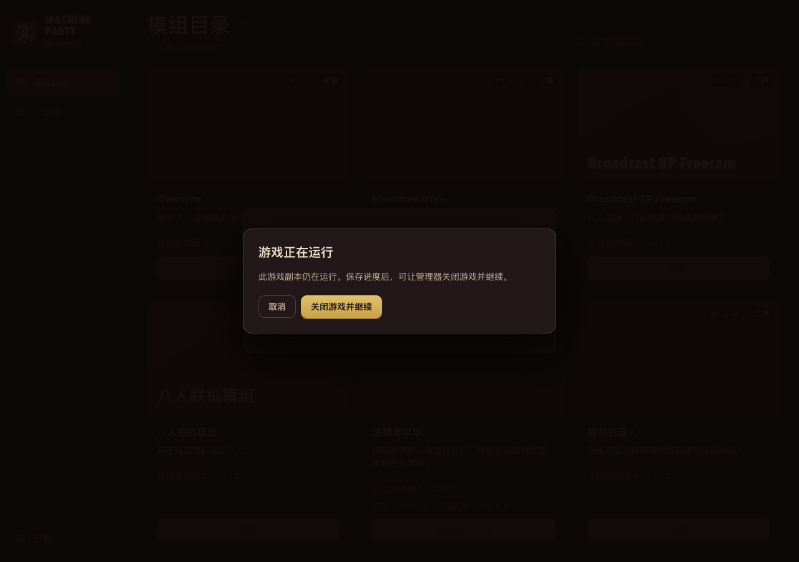
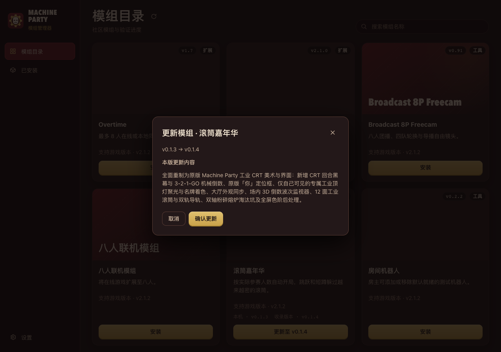

# 获取帮助

[English](../../SUPPORT.md) · **简体中文** · [繁體中文](../zh-TW/SUPPORT.md)

## 提问之前

- 阅读[项目主页](../readme/README.zh-CN.md)了解下载方式和 Windows 测试版支持的模组安装功能。
- 搜索[已有 Issues](https://github.com/JamesGZM/machine-party-mod-manager/issues)，包括已关闭的。

## 游戏正在运行时

先保存进度，再选择**关闭游戏并继续**或取消。如果游戏仍在运行，可以继续等待，或确认强制结束。强制结束可能丢失未保存的进度。如果 Windows 拒绝关闭请求，请手动退出游戏后重试。

## 更新单个已安装模组

- **Windows 预览版 0.1.2-11** — 打开“已安装”，点击“检查模组更新”。选择“更新至”，核对本机版本、目标版本和游戏副本路径，再点击“确认更新”。
- **Windows 测试版 0.1.2-12（见下图）** — 打开“模组目录”，点击“刷新模组列表”。选择“更新至”，核对版本及可用的更新说明，再点击“确认更新”。如果弹窗打开期间新增或修订了当前语言的说明，请阅读新内容后再次确认。

包校验失败时会保留旧版。如果替换文件时中断，请关闭游戏并重新打开管理器，以恢复已记录的版本。在模组目录中，有可用更新的模组也可从详情页选择“卸载”。

## 卸载 MPML 模组

打开“已安装”并选择“卸载”。对话框会显示这份游戏副本实际安装的模组版本。如果在原目录重新安装了同一个受支持版本的干净游戏，先前的 MPML 模组可能显示“需要修复”。选择“查看原因”→“卸载”来清理旧记录，验证完成后即可重新安装模组。

## 在哪里提问

| 情况 | 渠道 |
| --- | --- |
| 管理器运行异常或崩溃 | [问题报告](https://github.com/JamesGZM/machine-party-mod-manager/issues/new?template=bug_report.yml) |
| 想法或缺少的功能 | [功能建议](https://github.com/JamesGZM/machine-party-mod-manager/issues/new?template=feature_request.yml) |
| 推荐模组或模组新版本 | [模组投稿](https://github.com/JamesGZM/machine-party-mod-manager/issues/new?template=mod-submission.yml) |
| 安全问题 | 按[安全说明](SECURITY.md)私下报告 |

## 需要提供的信息

操作系统、管理器版本（设置页）、Steam 游戏版本、游戏目录是自动检测还是手动选择、操作步骤以及预期结果。请从路径和截图中去除个人信息。

模组本身或游戏的问题，请联系模组作者或游戏开发者。管理器在模组详情中提供了每位作者的链接。
