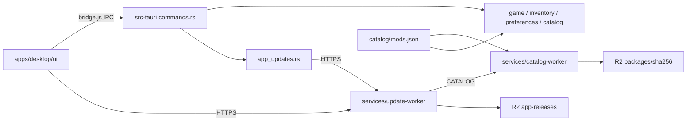

# 现行架构

[English](../../en/architecture/README.md) · **简体中文** · [繁體中文](../../zh-TW/architecture/README.md)

本文是唯一的现行架构说明。重大决策记录在同目录的 ADR；安装、切换与恢复仍是设计草案，待实机验证。

## 组件与边界

| 目录 | 职责 |
| --- | --- |
| `apps/desktop/src-tauri` | Tauri 2 外壳。`main.rs` 只负责组装；`commands.rs` 解码、校验 IPC 并转交；`game.rs` 识别 Steam 游戏副本；`installer.rs` 是无 Tauri 依赖的交易引擎与适配器工厂；`pck_loader.rs` 通过 `assets/mpm_bootstrap.gd` 与 `Machine Party.pck.modloader.json` 执行管理器自管 Godot PCK 加载器的补丁与还原；`inventory.rs` 读取各副本的安装记录；`preferences.rs` 保存手动选择；`catalog.rs` 内嵌目录并限制可打开的作者与项目主页（`open_project` 同时放行目录顶层 `repo` 与各模组 `repo`）；`app_updates.rs` 负责签名更新。 |
| `apps/desktop/ui` | 无构建步骤的原生 ES 模块。`bridge.js` 是唯一接触 Tauri 的文件；`catalog.js` 与 `versions.js` 为纯函数；`state.js` 保存界面状态；各 `*-view.js` 负责渲染。样式分三层：`tokens.css` 设计 token、`components.css` 通用组件、`style.css` 页面布局；`dom.js` 与 `icons.js` 创建组件与图标。 |
| `catalog/mods.json` | 管理器顶层 `repo`、模组收录 ID、序号、版本、三语文案、别名及声明式 `adapter` 配置的唯一来源（[ADR-002](ADR-002-catalog-source.md)）。 |
| `mods/<id>/` | 本仓库编写的自研 GDScript 玩法模组，经 `scripts/pack-mod.mjs` 确定性打包后上传至 R2 并由 catalog Worker 分发，配合内置自管加载器一键安装与还原（[ADR-009](ADR-009-bundled-first-party-mods.md)）。 |
| `services/update-worker` | 只读 Worker，从 R2 提供稳定清单与按版本固定的安装包（[ADR-003](ADR-003-desktop-updates.md)）。 |
| `scripts`、`tests` | 发布、部署、验收与边界检查；Node 测试分为 `ui`、`contracts`、`architecture`。Rust 单元测试放在各模块旁。 |

本机数据位于应用配置目录：`game-path.json` 保存玩家选择的游戏路径；`installations.json` 第一层键是游戏路径，第二层键是 `作者/仓库`，值为管理器安装的版本。界面语言与已忽略提示的管理器版本号（`dismissed-app-update`）存于 WebView 的 `localStorage`。

## 游戏定位与识别

Steam 上的 Machine Party（App ID 4108000）仅支持 Windows，不考虑在 macOS 上游玩。App 从 Steam 安装位置读取游戏库清单，在各库中查找 App ID 4108000 的安装清单，并区分保存的游戏根目录（用作 `installations.json` 的键）与解析出的实际存放可执行文件及 `Machine Party.pck` 的内层目录（如 `Machine Party_Windows`）。记录 Steam build、实际路径及数据文件哈希；兼容性以实测过的组合为准。玩家移动游戏后重新检查，备份按副本和安装前的文件指纹保存。

## 目录、搜索与下载

维护者发布固定的模组 ID、收录序号、作者、README 摘要、别名与主页。每个可安装版本另存上游标签或提交、资产名称、SHA-256、支持的游戏指纹、安装方式、所需加载器版本、已知冲突及下载路径。App 缓存最近一次成功读取的目录。

正式列表统一经自定义域名的 Cloudflare Worker 获取。发布时部署已审核的快照，GitHub 用于协作与发布；玩家浏览列表不依赖对 GitHub 的连接。中国大陆下载优先走同域名 Worker；允许再分发的已验证原文件优先存入私有 R2，其他资产根据授权与线路测试决定是否流式回源；只允许作者直连的资产另行标注限制。客户端启动时读取 Worker 快照，缓存通过校验的数据供离线浏览。每个版本通过 Release 资产 ID 对应 R2 键 `packages/sha256/<sha256>.zip`。仅开放允许镜像的安装包。端点契约、失败处理、发布与三网验收见[正式目录交付方案](../catalog/delivery.md)。

## 安装、切换与恢复（设计草案）

一键安装先用目录大小和 SHA-256 核对作者发布的 ZIP，再由 Rust 在暂存区准备 MPML 目录。Overtime 读取 CLI 包中的 payload 清单，保留上游的加载时序、版本与原版脚本指纹检查。Broadcast 和 Binary1936 读取资源树。MachineParty+、滚筒嘉年华与房间机器人已采用加载器格式。

安装事务记录来源指纹、转换规则版本与已安装文件指纹。三款八人玩法属于同一互斥组，切换时可保留其他加载器模组。单独分发转换包需要维护第二份发布产物，执行各上游安装器则需维护多套备份与还原程序。

旧版客户端仍可使用兼容目录与下载地址。已有的 Overtime MPML 安装可以继续使用。旧式受管 PCK 补丁可在模组详情选择「切换到加载器安装」，先验证新包，再还原已记录的副本并安装。手动安装的 mods/broadcast-8p 须先移出游戏目录。遇到未知文件变更时，还原会停止。

## 是否维护 fork

优先复用作者发布的资源，将转换规则随管理器版本维护。App 可以自行承担检测、备份及校验。若遇到无法从外部解决的交互或还原问题，记录可复现案例，优先向上游提交小改动。只有授权允许且确有必要时才维护安装器 fork，并保留原作者、来源及版本对照。

## 架构决策记录

- [ADR-001：项目边界，保留 Tauri 与原生 JS](ADR-001-project-boundaries.md)
- [ADR-002：模组目录的唯一来源](ADR-002-catalog-source.md)
- [ADR-003：签名的桌面更新](ADR-003-desktop-updates.md)
- [ADR-004：按语言组织文档](ADR-004-language-documentation.md)
- [ADR-005：模组安装交易与备份（提议）](ADR-005-install-transactions.md)
- [ADR-006 · 在线模组目录](ADR-006-online-catalog.md)
- [ADR-007：模组适配层与 macOS 模拟验证（提议）](ADR-007-mod-adapters.md)
- [ADR-008 · 下载缓存、启动检测与还原校验](ADR-008-cached-installations.md)
- [ADR-009：自研模组、R2 确定性打包与自管加载器规范（提议）](ADR-009-bundled-first-party-mods.md)
- [ADR-010 · 同仓库模组的独立安装记录](ADR-010-shared-repository-mods.md)
- [ADR-011 · 安装前统一准备 MPML](ADR-011-prepare-mpml.md)
- [ADR-012 · 更新单个已安装模组](ADR-012-single-mod-updates.md)

- [ADR-013 · 从签名目录安装原生模组](ADR-013-signed-native-installs.md)
- [ADR-014 · Steam 验证成功后清理受管模组](ADR-014-steam-restore.md)
- [ADR-015 · 多小游戏共存注册中心](ADR-015-multi-minigame-hub.md)
- [ADR-016 · 基于 R2 图床的可选模组封面规范](ADR-016-r2-mod-covers.md)
