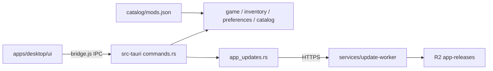

# 现行架构

[English](../../en/architecture/README.md) · **简体中文** · [繁體中文](../../zh-TW/architecture/README.md)

本文是唯一的现行架构说明。重大决策记录在同目录的 ADR；安装、切换与恢复仍是设计草案，待实机验证。

## 组件与边界

| 目录 | 职责 |
| --- | --- |
| `apps/desktop/src-tauri` | Tauri 2 外壳。`main.rs` 只负责组装；`commands.rs` 解码、校验 IPC 并转交；`game.rs` 识别 Steam 游戏副本；`inventory.rs` 读取各副本的安装记录；`preferences.rs` 保存手动选择；`catalog.rs` 内嵌目录并限制可打开的作者页；`app_updates.rs` 负责签名更新。 |
| `apps/desktop/ui` | 无构建步骤的原生 ES 模块。`bridge.js` 是唯一接触 Tauri 的文件；`catalog.js`、`versions.js` 为纯函数；`state.js` 保存界面状态；各 `*-view.js` 负责渲染。 |
| `catalog/mods.json` | 收录 ID、序号、版本、三语文案与别名的唯一来源（[ADR-002](ADR-002-catalog-source.md)）。 |
| `services/update-worker` | 只读 Worker，从 R2 提供稳定清单与按版本固定的安装包（[ADR-003](ADR-003-desktop-updates.md)）。 |
| `scripts`、`tests` | 发布、部署、验收与边界检查；Node 测试分为 `ui`、`contracts`、`architecture`。Rust 单元测试放在各模块旁。 |

本机数据位于应用配置目录：`game-path.json` 保存玩家选择的游戏路径；`installations.json` 第一层键是游戏路径，第二层键是 `作者/仓库`，值为管理器安装的版本。界面语言存于 WebView 的 localStorage。

## 游戏定位与识别

首版以 Windows Steam 版为目标。从 Steam 安装位置读取游戏库清单，在各库中查找 App ID 4108000 的安装清单，用其安装路径寻找游戏可执行文件及 PCK。允许从已知的版本子目录定位文件。记录 Steam build、实际路径及数据文件哈希；兼容性以实测过的组合为准。玩家移动游戏后重新检查，备份按副本和安装前的文件指纹保存。

## 目录、搜索与下载

维护者发布固定的模组 ID、收录序号、作者、README 摘要、别名与主页。每个可安装版本另存上游标签或提交、资产名称、SHA-256、支持的游戏指纹、安装方式、所需加载器版本、已知冲突及下载路径。App 缓存最近一次成功读取的目录。

正式列表统一经自定义域名的 Cloudflare Worker 获取。发布时部署已审核的快照，GitHub 用于协作与发布；玩家浏览列表不依赖对 GitHub 的连接。中国大陆下载优先走同域名 Worker；允许再分发的已验证原文件优先存入私有 R2，其他资产根据授权与线路测试决定是否流式回源；只允许作者直连的资产另行标注限制。现有客户端使用随包发布的 `catalog/mods.json`。端点契约、失败处理、发布与三网验收见[正式目录交付方案](../catalog/delivery.md)。

## 安装、切换与恢复（设计草案）

完整流程与约束见 [ADR-005](ADR-005-install-transactions.md)。摘要：锁定副本并检查游戏进程、版本、空间与依赖；在暂存区备好并校验安装包；先写入安装记录与备份，再应用；读回验证后才记录成功；中断后根据记录与磁盘实况恢复，遇到 Steam 更新或未知修改时停止覆盖。

## 是否维护 fork

优先使用作者公开的 CLI 或底层安装脚本。App 可以自行承担检测、备份及校验。若遇到无法从外部解决的交互或还原问题，记录可复现案例，优先向上游提交小改动。只有授权允许且确有必要时才维护安装器 fork，并保留原作者、来源及版本对照。

## 架构决策记录

- [ADR-001：项目边界，保留 Tauri 与原生 JS](ADR-001-project-boundaries.md)
- [ADR-002：模组目录的唯一来源](ADR-002-catalog-source.md)
- [ADR-003：签名的桌面更新](ADR-003-desktop-updates.md)
- [ADR-004：按语言组织文档](ADR-004-language-documentation.md)
- [ADR-005：模组安装交易与备份（提议）](ADR-005-install-transactions.md)
