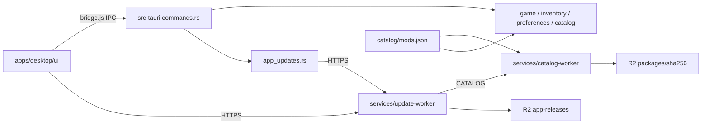

# 现行架构

[English](../../en/architecture/README.md) · **简体中文** · [繁體中文](../../zh-TW/architecture/README.md)

本文是唯一的现行架构说明。重大决策记录在同目录的 ADR；安装、切换与恢复仍是设计草案，待实机验证。

## 组件与边界

| 目录 | 职责 |
| --- | --- |
| `apps/desktop/src-tauri` | Tauri 2 外壳。`main.rs` 只负责组装；`commands.rs` 解码、校验 IPC 并转交；`game.rs` 识别 Steam 游戏副本；`installer.rs` 是无 Tauri 依赖的交易引擎与适配器工厂；`pck_loader.rs` 通过 `assets/mpm_bootstrap.gd` 与 `Machine Party.pck.modloader.json` 执行管理器自管 Godot PCK 加载器的补丁与还原；`inventory.rs` 读取各副本的安装记录；`preferences.rs` 保存手动选择；`catalog.rs` 内嵌目录并限制可打开的作者与项目主页（`open_project` 同时放行目录顶层 `repo` 与各模组 `repo`）；`app_updates.rs` 负责签名更新。 |
| `apps/desktop/ui` | 无构建步骤的原生 ES 模块。`bridge.js` 是唯一接触 Tauri 的文件；`catalog.js` 与 `versions.js` 为纯函数；`state.js` 保存界面状态；各 `*-view.js` 负责渲染。样式分三层：`tokens.css` 设计 token、`components.css` 通用组件、`style.css` 页面布局；`dom.js` 与 `icons.js` 创建组件与图标。 |
| `catalog/mods.json` | 管理器顶层 `repo`、模组收录 ID、序号、版本、三语文案、别名及声明式 `adapter` 配置的唯一来源（[ADR-002](ADR-002-catalog-source.md)）。 |
| `mods/<id>/` | 本仓库编写的自研 GDScript 玩法模组，经 `scripts/pack-mod.mjs` 确定性打包后上传至 R2 并由 catalog Worker 分发，配合内置自管加载器一键安装与还原（[ADR-009](ADR-009-bundled-first-party-mods.md)）。 |
| `services/update-worker` | 只读 Worker，从 R2 提供稳定清单与按版本固定的安装包（[ADR-003](ADR-003-desktop-updates.md)）。 |
| `scripts`、`tests` | 发布、部署、验收与边界检查；Node 测试分为 `ui`、`contracts`、`architecture`。Rust 单元测试放在各模块旁。 |

本机数据位于应用配置目录：`game-path.json` 保存玩家选择的游戏路径；`installations.json` 第一层键是游戏路径，第二层键是 `作者/仓库`，值为管理器安装的版本。界面语言与已忽略提示的管理器版本号（`dismissed-app-update`）存于 WebView 的 `localStorage`。

## 游戏定位与识别

Steam 上的 Machine Party（App ID 4108000）仅支持 Windows，不考虑在 macOS 上游玩。App 从 Steam 安装位置读取游戏库清单，在各库中查找 App ID 4108000 的安装清单，并区分保存的游戏根目录（用作 `installations.json` 的键）与解析出的实际存放可执行文件及 `Machine Party.pck` 的内层目录（如 `Machine Party_Windows`）。记录 Steam build、实际路径及数据文件哈希；兼容性以实测过的组合为准。玩家移动游戏后重新检查，备份按副本和安装前的文件指纹保存。

## 目录、搜索与下载

维护者发布固定的模组 ID、收录序号、作者、README 摘要、别名与主页。每个可安装版本另存上游标签或提交、资产名称、SHA-256、支持的游戏指纹、安装方式、所需加载器版本、已知冲突及下载路径。App 缓存最近一次成功读取的目录。

正式列表统一经自定义域名的 Cloudflare Worker 获取。发布时部署已审核的快照，GitHub 用于协作与发布；玩家浏览列表不依赖对 GitHub 的连接。中国大陆下载优先走同域名 Worker；允许再分发的已验证原文件优先存入私有 R2，其他资产根据授权与线路测试决定是否流式回源；只允许作者直连的资产另行标注限制。客户端启动时读取 Worker 快照，缓存通过校验的数据供离线浏览。每个版本通过 Release 资产 ID 对应 R2 键 `packages/sha256/<sha256>.zip`。仅开放允许镜像的安装包。端点契约、失败处理、发布与三网验收见[正式目录交付方案](../catalog/delivery.md)。

## 安装、切换与恢复（设计草案）

完整流程与约束见 [ADR-005](ADR-005-install-transactions.md)、[ADR-007](ADR-007-mod-adapters.md) 与 [ADR-009](ADR-009-bundled-first-party-mods.md)。摘要：无 Tauri 依赖的 Rust 交易引擎负责锁定副本并检查游戏进程、版本、空间与冲突；在 Rust 端从 Worker 端点下载安装包到暂存区并校验；写入安装前指纹与分级备份（支持差量还原时镜像还原数据与离线 CLI，否则保存整包 PCK 备份）；再依据 `catalog/mods.json` 中的声明式 `adapter` 配置派发至内置适配器工厂（`upstream-cli`、`loader-files`）。

### 为什么加载器方式与直接修改 PCK 方式无法共存

社区模组在 `Machine Party.pck` 上分为两种底层加载机制，彼此在文件与运行时层面完全互斥：

- **加载器方式（`loader-files` + `autoLoader` / MPML）**：`Overtime`（v1.7 MPML 版）、`MachineParty+` 与 `滚筒嘉年华` 各自安装于 `<pckDir>/mods/<id>/`，通过 `autoload/ModLoader`（管理器内置 `pck_loader.rs` + `assets/mpm_bootstrap.gd`，或玩家既有的外部 `MachinePartyModLoader.exe`）动态挂载。加载器模组之间可共存；`mpm_bootstrap.gd` 在 `_init()` 阶段执行 `_discover_and_init_mods()`，确保 `priority: -1000` 模组能在游戏原版单例（如 `NetworkManager`）加载前完成哨兵校验与覆盖包挂载。
- **直接修改 PCK 方式（`upstream-cli`，`exclusive: "pck"`）**：`Broadcast 8P Freecam` 与 `Binary1936 八人模组` 均强校验原版 `Machine Party.pck` 基线（`634,798,100` 字节，SHA-256 `326cc398...`），再直接重建或打补丁改写 PCK 数据包。
- **无法共存的技术原因**：
  1. **PCK 基线指纹与 GDPC 索引冲突**：内置加载器或 MPML 会改写 `res://project.binary` 的 `autoload/ModLoader` 并追加 GDPC v3 目录索引（生成 `Machine Party.pck.modloader.json`），导致 PCK 的 SHA-256 偏离原版，直接改包安装器会因基线不符而拒绝写入（`baselineMismatch`）；反之，直接改包工具重写 PCK 后会抹除加载器入口或破坏索引。
  2. **运行时脚本 MD5 门禁与覆盖冲突**：MPML 覆盖类模组（如 Overtime）挂载 `overtime_overlay.zip` 前会逐项校验 PCK 内原版 `.gdc` 的 MD5 指纹（`vanilla_md5.json`），修改过的 PCK 会触发版本不匹配并拒绝挂载。
  3. **备份与还原边界隔离**：PCK 补丁器依赖面向原版基线的整包或差量备份来回滚，而受管加载器仅在最后一个受管 `mods/<id>/` 移除后才把 PCK 截断还原为原版。
- **冲突区分与一键切换**：管理器严格区分 `modConflict`（仅与管理器受管安装的互斥模组冲突）与 `loaderConflict`（检测到外部 `MachinePartyModLoader.exe` 或 `mods/` 中存在未受管文件）。处于 `modConflict` 时，界面直接提供一键**切换**（`switch_from_zip`）：先在暂存区下载并预检目标套件，再卸载现有互斥模组、校验 PCK 已完整还原为原版基线，最后再安装目标模组。

读回验证后才记录成功；中断后根据记录与磁盘实况恢复，遇到 Steam 更新或未知修改时停止覆盖。在进入 Windows P2 实机验收前，macOS 开发期通过 L1（合成 PCK 与 `FakeRunner`）、L2（真实子进程）、L3（本机原版 PCK 搭配 Mono）三层模拟验证。

## 是否维护 fork

优先使用作者公开的 CLI 或底层安装脚本。App 可以自行承担检测、备份及校验。若遇到无法从外部解决的交互或还原问题，记录可复现案例，优先向上游提交小改动。只有授权允许且确有必要时才维护安装器 fork，并保留原作者、来源及版本对照。

## 架构决策记录

- [ADR-001：项目边界，保留 Tauri 与原生 JS](ADR-001-project-boundaries.md)
- [ADR-002：模组目录的唯一来源](ADR-002-catalog-source.md)
- [ADR-003：签名的桌面更新](ADR-003-desktop-updates.md)
- [ADR-004：按语言组织文档](ADR-004-language-documentation.md)
- [ADR-005：模组安装交易与备份（提议）](ADR-005-install-transactions.md)
- [ADR-006 · 在线模组目录](ADR-006-online-catalog.md)
- [ADR-007：模组适配层与 macOS 模拟验证（提议）](ADR-007-mod-adapters.md)
- [ADR-008 · 下载缓存、启动检测与还原校验](ADR-008-cached-installations.md)
- [ADR-009：自研模组、R2 确定性打包与自管加载器规范（提议）](ADR-009-bundled-first-party-mods.md)
