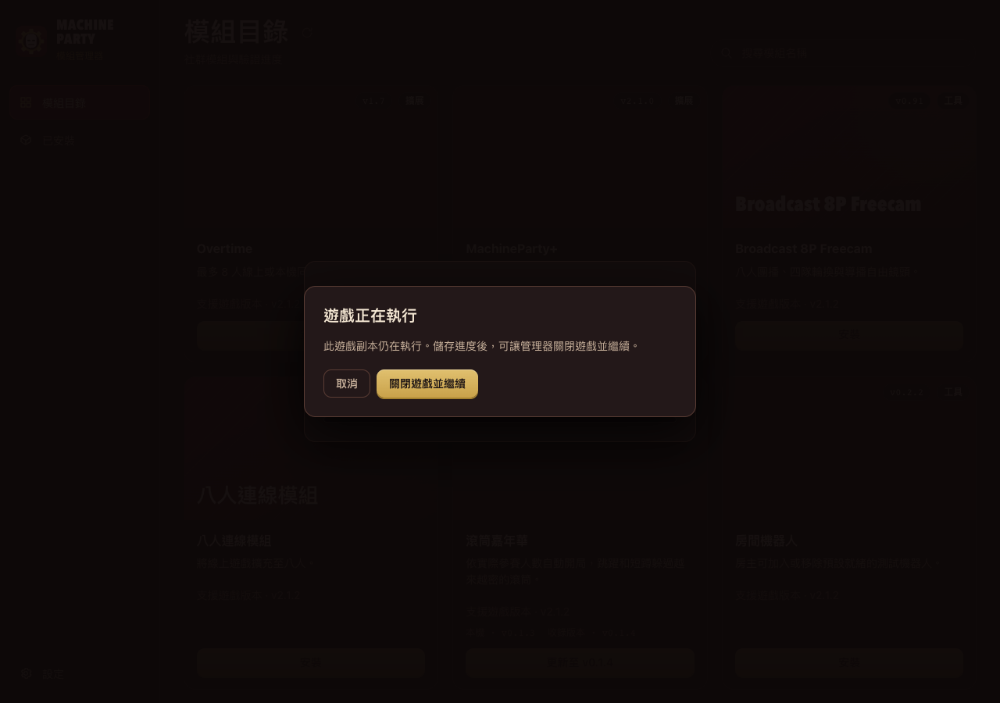

# 取得協助

[English](../../SUPPORT.md) · [简体中文](../zh-CN/SUPPORT.md) · **繁體中文**

## 提問之前

- 閱讀[專案首頁](../readme/README.zh-TW.md)了解下載方式與 Windows 測試版支援的模組安裝功能。
- 搜尋[既有 Issues](https://github.com/JamesGZM/machine-party-mod-manager/issues)，包括已關閉的。

## 遊戲正在執行時

先儲存進度，再選擇**關閉遊戲並繼續**或取消。如果遊戲仍在執行，可以繼續等待，或確認強制結束。強制結束可能遺失未儲存的進度。如果 Windows 拒絕關閉請求，請手動退出遊戲後重試。

## 更新單一已安裝模組

- **Windows 預覽版 0.1.2-11** — 開啟「已安裝」，點選「檢查模組更新」。選擇「更新至」，核對本機版本、目標版本與遊戲副本路徑，再點選「確認更新」。
- **Windows 測試版 0.1.2-12（見下圖）** — 開啟「模組目錄」，點選「重新整理模組列表」。選擇「更新至」，核對版本與可用的更新說明，再點選「確認更新」。如果彈窗開啟期間新增或修訂了目前語言的說明，請閱讀新內容後再次確認。

套件校驗失敗時會保留舊版。若替換檔案時中斷，請關閉遊戲並重新開啟管理器，以復原已記錄的版本。在模組目錄中，有可用更新的模組也可從詳情頁選擇「解除安裝」。

## 解除安裝 MPML 模組

開啟「已安裝」並選擇「解除安裝」。對話框會顯示這份遊戲副本實際安裝的模組版本。若在原目錄重新安裝了同一個受支援版本的乾淨遊戲，先前的 MPML 模組可能顯示「需要修復」。選擇「查看原因」→「解除安裝」來清理舊記錄，驗證完成後即可重新安裝模組。

## 在哪裡提問

| 情況 | 管道 |
| --- | --- |
| 管理器執行異常或當機 | [問題回報](https://github.com/JamesGZM/machine-party-mod-manager/issues/new?template=bug_report.yml) |
| 想法或缺少的功能 | [功能建議](https://github.com/JamesGZM/machine-party-mod-manager/issues/new?template=feature_request.yml) |
| 推薦模組或模組新版本 | [模組投稿](https://github.com/JamesGZM/machine-party-mod-manager/issues/new?template=mod-submission.yml) |
| 安全問題 | 依[安全說明](SECURITY.md)私下回報 |

## 需要提供的資訊

作業系統、管理器版本（設定頁）、Steam 遊戲版本、遊戲目錄是自動偵測還是手動選擇、操作步驟以及預期結果。請從路徑與截圖中移除個人資訊。

模組本身或遊戲的問題，請聯絡模組作者或遊戲開發者。管理器在模組詳情中提供每位作者的連結。
