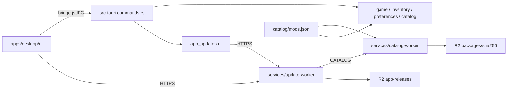

# 現行架構

[English](../../en/architecture/README.md) · [简体中文](../../zh-CN/architecture/README.md) · **繁體中文**

本文是唯一的現行架構說明。重大決策記錄在同目錄的 ADR；安裝、切換與恢復仍是設計草案，待實機驗證。

## 元件與邊界

| 目錄 | 職責 |
| --- | --- |
| `apps/desktop/src-tauri` | Tauri 2 殼層。`main.rs` 只組裝；`commands.rs` 解碼、驗證 IPC 並轉交；`game.rs` 辨識 Steam 遊戲副本；`installer.rs` 為無 Tauri 相依的交易引擎與適配器工廠；`pck_loader.rs` 透過 `assets/mpm_bootstrap.gd` 與 `Machine Party.pck.modloader.json` 執行管理器自管 Godot PCK 載入器的修補與還原；`inventory.rs` 讀取各副本的安裝紀錄；`preferences.rs` 保存手動選擇；`catalog.rs` 內嵌目錄並限制可開啟的作者與專案首頁（`open_project` 同時允許目錄頂層 `repo` 與各模組 `repo`）；`app_updates.rs` 負責簽章更新。 |
| `apps/desktop/ui` | 無建置步驟的原生 ES 模組。`bridge.js` 是唯一接觸 Tauri 的檔案；`catalog.js` 與 `versions.js` 為純函式；`state.js` 保存介面狀態；各 `*-view.js` 負責繪製。樣式分三層：`tokens.css` 設計 token、`components.css` 共用元件、`style.css` 頁面版面；`dom.js` 與 `icons.js` 建立元件與圖示。 |
| `catalog/mods.json` | 管理器頂層 `repo`、模組收錄 ID、序號、版本、三語文案、別名與宣告式 `adapter` 設定的唯一來源（[ADR-002](ADR-002-catalog-source.md)）。 |
| `mods/<id>/` | 本儲存庫開發的自研 GDScript 玩法模組，由 `scripts/pack-mod.mjs` 確定性封裝為 ZIP 上傳至 R2 並經由 catalog Worker 分發，搭配內建自管載入器一鍵安裝與還原（[ADR-009](ADR-009-bundled-first-party-mods.md)）。 |
| `services/update-worker` | 唯讀 Worker，自 R2 提供穩定清單與按版本固定的安裝包（[ADR-003](ADR-003-desktop-updates.md)）。 |
| `scripts`、`tests` | 發布、部署、驗收與邊界檢查；Node 測試分為 `ui`、`contracts`、`architecture`。Rust 單元測試放在各模組旁。 |

本機資料位於應用程式設定目錄：`game-path.json` 保存玩家選擇的遊戲路徑；`installations.json` 第一層鍵是遊戲路徑，第二層鍵是 `作者/倉庫`，值為管理器安裝的版本。介面語言與已略過提示的管理器版本號（`dismissed-app-update`）存於 WebView 的 `localStorage`。

## 遊戲定位與辨識

Steam 上的 Machine Party（App ID 4108000）僅支援 Windows，不考慮在 macOS 上遊玩。App 由 Steam 安裝位置讀取遊戲庫清單，在各庫查找 App ID 4108000 的安裝清單，並區分已保存的遊戲根目錄（作為 `installations.json` 的鍵）與解析出的實際存放執行檔及 `Machine Party.pck` 的內層目錄（如 `Machine Party_Windows`）。記錄 Steam build、實際路徑及資料檔雜湊；相容性以經實測的組合為準。玩家搬移遊戲後重新檢查，備份按副本和安裝前的檔案指紋保存。

## 目錄、搜尋與下載

維護者發布固定的模組 ID、收錄序號、作者、README 摘要、別名與首頁。每個可安裝版本另存上游標籤或提交、資產名稱、SHA-256、支援的遊戲指紋、安裝方式、所需載入器版本、已知衝突及下載路徑。App 快取最近一次成功讀取的目錄。

正式列表統一經自訂網域的 Cloudflare Worker 取得。發布時部署已審核快照，GitHub 用於協作與發布；玩家瀏覽列表不依賴對 GitHub 的連線。大陸下載優先走同網域 Worker；允許再散布的已驗證原檔優先存入私有 R2，其他資產依授權與線路測試決定是否串流回源；只允許作者直連的資產另標限制。客戶端啟動時讀取 Worker 快照，快取通過驗證的資料供離線瀏覽。每個版本透過 Release 資產 ID 對應 R2 鍵 `packages/sha256/<sha256>.zip`。僅開放允許鏡像的套件。端點契約、失敗處理、發布與三網驗收見[正式目錄交付方案](../catalog/delivery.md)。

## 安裝、切換與恢復（設計草案）

完整流程與約束見 [ADR-005](ADR-005-install-transactions.md)、[ADR-007](ADR-007-mod-adapters.md) 與 [ADR-009](ADR-009-bundled-first-party-mods.md)。摘要：無 Tauri 相依的 Rust 交易引擎負責鎖定副本並檢查遊戲進程、版本、空間與衝突；在 Rust 端從 Worker 端點下載套件到暫存區並校驗；寫入安裝前指紋與分級備份（支援差量還原時鏡像還原資料與離線 CLI，否則保存整包 PCK 備份）；再依 `catalog/mods.json` 中的宣告式 `adapter` 設定派發至內建適配器工廠（`upstream-cli`、`loader-files`）。

### 為什麼載入器方式與直接修改 PCK 方式無法共存

社群模組在 `Machine Party.pck` 上分為兩種底層載入機制，彼此在檔案與執行期層面完全互斥：

- **載入器方式（`loader-files` + `autoLoader` / MPML）**：`Overtime`（v1.7 MPML 版）、`MachineParty+` 與 `滾筒嘉年華` 各自安裝於 `<pckDir>/mods/<id>/`，透過 `autoload/ModLoader`（管理器內建 `pck_loader.rs` + `assets/mpm_bootstrap.gd`，或玩家既有的外部 `MachinePartyModLoader.exe`）動態掛載。載入器模組之間可彼此共存；`mpm_bootstrap.gd` 在 `_init()` 階段執行 `_discover_and_init_mods()`，確保 `priority: -1000` 模組能在遊戲原版單例（如 `NetworkManager`）載入前完成哨兵校驗與覆蓋包掛載。
- **直接修改 PCK 方式（`upstream-cli`，`exclusive: "pck"`）**：`Broadcast 8P Freecam` 與 `Binary1936 八人模組` 皆強校驗原版 `Machine Party.pck` 基線（`634,798,100` 位元組，SHA-256 `326cc398...`），再直接重建或打補丁改寫 PCK 資料包。
- **無法共存的技術原因**：
  1. **PCK 基線指紋與 GDPC 索引衝突**：內建載入器或 MPML 會改寫 `res://project.binary` 的 `autoload/ModLoader` 並追加 GDPC v3 目錄索引（產生 `Machine Party.pck.modloader.json`），使 PCK 的 SHA-256 偏離原版，直接改包安裝器會因基線不符而拒絕寫入（`baselineMismatch`）；反之，直接改包工具重寫 PCK 後會抹除載入器入口或破壞索引。
  2. **執行期腳本 MD5 門禁與覆蓋衝突**：MPML 覆蓋類模組（如 Overtime）掛載 `overtime_overlay.zip` 前會逐項校驗 PCK 內原版 `.gdc` 的 MD5 指紋（`vanilla_md5.json`），修改過的 PCK 會觸發版本不符而拒絕掛載。
  3. **備份與還原邊界隔離**：PCK 補丁器依賴面向原版基線的整包或差量備份進行回滾，而受管載入器僅在最後一個受管 `mods/<id>/` 移除後才將 PCK 截斷還原為原版。
- **衝突區分與一鍵切換**：管理器嚴格區分 `modConflict`（僅與管理器受管安裝的互斥模組衝突）與 `loaderConflict`（偵測到外部 `MachinePartyModLoader.exe` 或 `mods/` 中存在未受管檔案）。處於 `modConflict` 時，介面直接提供一鍵**切換**（`switch_from_zip`）：先在暫存區下載並預檢目標套件，再解除安裝現有互斥模組、校驗 PCK 已完整還原為原版基線，最後才安裝目標模組。

讀回驗證後才記錄成功；中斷後依紀錄與磁碟實況恢復，遇到 Steam 更新或未知修改時停止覆寫。在進入 Windows P2 實機驗收前，macOS 開發期透過 L1（合成 PCK 與 `FakeRunner`）、L2（真實子進程）、L3（本機原版 PCK 搭配 Mono）三層模擬驗證。

## 是否維護 fork

先用作者公開的 CLI 或底層安裝腳本。App 可自行承擔偵測、備份及校驗。若遇到無法從外部解決的互動或還原問題，記錄可重現案例，優先向上游提交小改動。授權允許且確有必要時才維護安裝器 fork，保留原作者、來源及版本對照。

## 架構決策紀錄

- [ADR-001：專案邊界，保留 Tauri 與原生 JS](ADR-001-project-boundaries.md)
- [ADR-002：模組目錄的唯一來源](ADR-002-catalog-source.md)
- [ADR-003：簽章的桌面更新](ADR-003-desktop-updates.md)
- [ADR-004：按語言組織文件](ADR-004-language-documentation.md)
- [ADR-005：模組安裝交易與備份（提議）](ADR-005-install-transactions.md)
- [ADR-006 · 線上模組目錄](ADR-006-online-catalog.md)
- [ADR-007：模組適配層與 macOS 模擬驗證（提議）](ADR-007-mod-adapters.md)
- [ADR-008 · 下載快取、啟動偵測與還原校驗](ADR-008-cached-installations.md)
- [ADR-009：自研模組、R2 確定性打包與自管載入器規範（提議）](ADR-009-bundled-first-party-mods.md)
