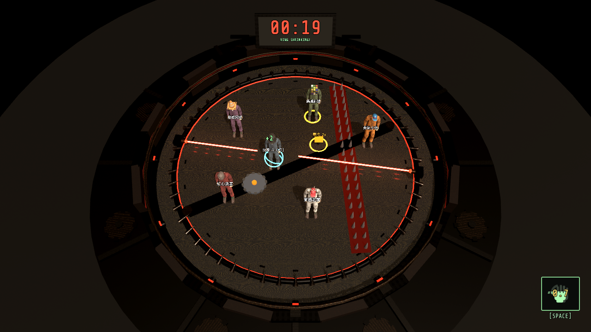

# Spike Ring（尖刺圆环）

`spike-ring` 是接入**多小游戏共存注册中心（Multi-Minigame Coexistence Hub）**的俯视 2.5D 圆形机械竞技场生存小游戏模组（通过 R2 + 目录 Worker 发布 ZIP 套件），占用原版未使用的 `Globals.MinigameIdentifier.BurnRecycle = 17` 槽位，可与 [`roller-carnival`](../roller-carnival/README.md)、[`bubble-blitz`](../bubble-blitz/README.md) 同时安装共存，共同出现在官方默认轮换、自定义歌单、街机模式、本地同屏与过场 15 格 CRT 抽签池中。



- **模组 ID**：`spike-ring`
- **版本**：`0.1.0`（目录清单对应 `v0.1.0`）
- **授权**：`GPL-3.0-only`
- **目标游戏版本**：Steam Windows `v2.1.2`
- **设计参数与算法细节**：[Spike Ring 设计与开发文档](DESIGN.md)
- **开发与打包规范**：[自研模组开发、测试、接入与打包规范](../../docs/zh-CN/development/mod-development.md) · [ADR-009](../../docs/zh-CN/architecture/ADR-009-bundled-first-party-mods.md) · [ADR-015](../../docs/zh-CN/architecture/ADR-015-multi-minigame-hub.md)

## 核心玩法与规则

- **3 秒准备 + 60 秒生存计时**：
  - 开局 3 秒准备期间可自由移动、跳跃熟悉手感，不会出局且禁用推人；倒计时结束后正式启动 60 秒计时、机关生成与推人判定。
  - 所有玩家出局或 60 秒计时结束时进入本轮结算；出局玩家保持俯视全景观战，不中途复活。
- **圆形尖刺竞技场与三类工业机关**：
  - 58° 高角度斜俯视 3D 工业舞台（自带原版 CRT 后处理与角色贴地阴影），玩家触碰外圈尖刺墙或激活中的机关即出局。
  - 按 `WARMUP → MIXED → FRENZY` 三阶段混合生成**工业等离子电弧激光**（双端高压发射塔，可 `Space` 跳跃越过）、**高速轨道电锯**（不可跳，必须横移躲避）与**喷火带**（可跳或绕行），全部经过安全生成器（未来 2 秒网格模拟 + BFS 逃生通道校验）确保绝不无解。
- **推人博弈与防锁死**：
  - 鼠标左键向前方扇形区域推击最近对手，命中后目标摔倒 `0.30s`（期间仅受击退、不可移动），爬起后获得 `0.20s` 免推保护，施放者冷却 `1.5s`。
- **动态人数自适应与计分**：
  - 不写死人数上限，自动适配 2–16 人联机或本地对局；正式阶段每秒存活 `+1`、成功推倒对手 `+2`、60 秒存活完成额外 `+10`。

## 操作按键

| 按键 | 功能 |
| --- | --- |
| `W / A / S / D` | 按屏幕方向移动 |
| 鼠标移动 | 控制角色朝向 |
| 鼠标左键 | 向前方扇形区域推人（`1.5s` 冷却） |
| `Space`（空格） | 跳跃（可越过激光线） |

## 文件结构

| 文件 | 打入 R2 ZIP | 职责 |
| --- | --- | --- |
| `mod.json` | 是 | 模组清单与入口声明 |
| `main.gd` | 是 | MPML API v2 入口：注册至多小游戏共存中心（槽位 `BurnRecycle = 17`） |
| `config.gd` | 是 | 竞技场尺寸、难度曲线、关卡主题与同步参数配置 |
| `arena_meshes.gd` | 是 | 程序化圆形机械舞台、外围工厂环境、激光机关缓存资源与 CRT 图标 |
| `spike_ring_game.gd` | 是 | 主游戏模拟、安全生成器、房主权威联机同步、AI 预览与 `--self-test` |
| `official_minigame.gd` | 是 | 官方 `Minigame` 信号、参赛名单与结算入口 |
| `override_game.gd` | 是 | 多小游戏共存中心驱动：联机默认/自定义/街机轮换与场景加载 |
| `override_local_game.gd` | 是 | 多小游戏共存中心驱动：本地同屏轮换与场景加载 |
| `override_playlist.gd` | 是 | 多小游戏共存中心驱动：大厅自定义歌单多模组展示 |
| `override_picker.gd` | 是 | 多小游戏共存中心驱动：过场 15 格 CRT 抽签与三语简报 |
| `README.md` / `DESIGN.md` / `project.godot` / `spike_ring_scene.tscn` / `run_mac.sh` | 否 | 文档与 macOS 本地开发预览/测试辅助脚本 |

## 本地开发、自测与打包

```sh
# 1. macOS 独立试玩
./mods/spike-ring/run_mac.sh play

# 2. 运行 Godot 4.5.2 headless 自测（输出 SELF_TEST_PASSED）
./mods/spike-ring/run_mac.sh --self-test

# 3. 截取 1280x720 封面图
./mods/spike-ring/run_mac.sh --screenshot apps/desktop/ui/images/spike-ring.png

# 4. 校验打包、多小游戏共存回归测试与全仓契约
node scripts/pack-mod.mjs --all --verify-catalog
npm run check:architecture && npm test
```

## 验证状态

- ✅ macOS Godot 4.5.2 `--self-test`、多小游戏共存回归测试（与 `roller-carnival`、`bubble-blitz` 同时加载）及确定性 ZIP 打包校验通过。
- ⏳ Windows + Steam `v2.1.2` 实机联机对局与卸载还原待验收（目录当前保持 `verified: false`）。
